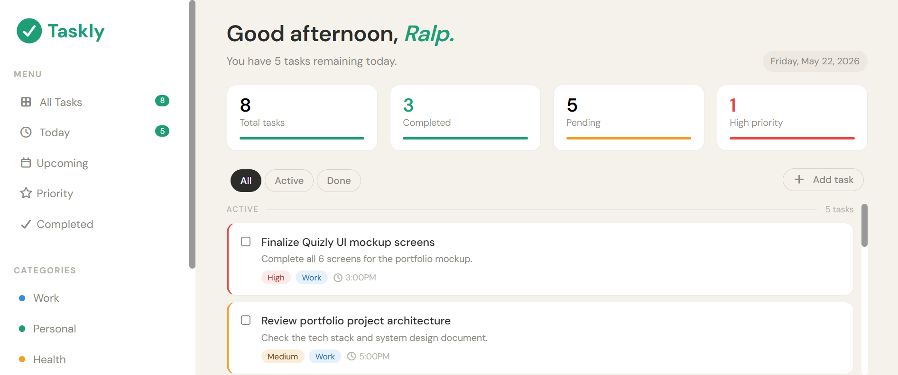
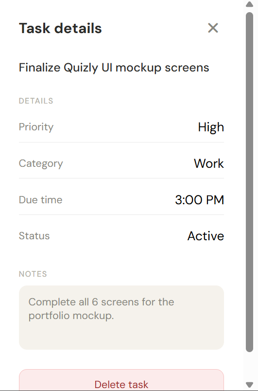
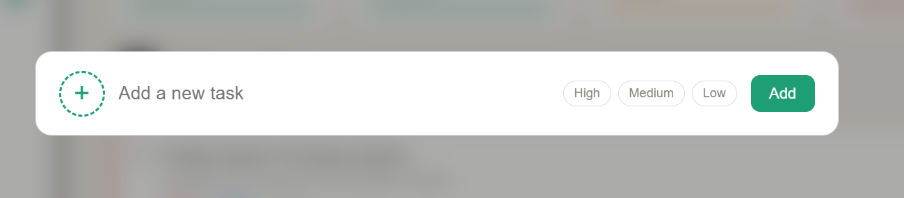
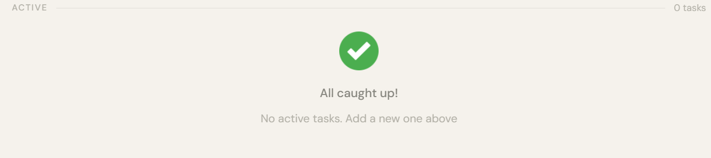

# Taskly — To Do List Web App

A clean, minimalist task management web app prototype built as a portfolio project. Designed with a focus on simplicity, calm productivity, and elegant UI.

---

## Live Preview

Open `src/index.html` directly in any modern browser — no build step, no dependencies, and no server required.

---

## Screenshots

### Dashboard

_Main app interface featuring sidebar navigation, stat cards, filters, and task lists._


### Task Detail Panel

_Slide-in task detail panel with editable notes and task metadata._



### Quick Add Overlay

_Lightweight overlay for rapid task creation with priority selection._



### Empty State

_Empty state banner displayed when no active tasks remain._



---

## Features

### Task Creation

- **Quick add bar** — Instantly create tasks by typing a title and pressing Enter or clicking Add
- **Priority chips** — Select High / Med / Low priority before task creation
- **Full task form** — Create detailed tasks with title, description, category, priority, and due time

### User Authentication & Persistence

- Built-in **Sign in** and **Create account** forms for per-user access
- Tasks are saved to browser `localStorage` for each signed-in account
- Reloading and signing in again restores tasks, stats, and badges

### Task Management

- **Task cards** with title, description, category tags, priority tags, and due time
- **Priority border indicators** using color-coded visual accents
- **Checkbox toggle** to move tasks between Active and Completed sections
- **Hover actions** for viewing task details or deleting tasks
- **Empty state handling** when no active tasks remain
- **Mobile-responsive sidebar navigation** for smooth use on smaller screens

### Filtering

- Sidebar navigation filters:
  - All Tasks
  - Today
  - Upcoming
  - Priority
  - Completed

- Category filters:
  - Work
  - Personal
  - Health
  - Learning

- View filter bar:
  - All
  - Active
  - Done

### Task Detail Panel

- Slide-in panel interaction
- Displays:
  - Title
  - Status
  - Category
  - Priority
  - Due time
  - Editable notes

### Stats & Dynamic UI

- Live stat cards:
  - Total Tasks
  - Completed
  - Pending
  - High Priority

- Dynamic UI updates:
  - Real-time badge counts
  - Personalized greeting based on time of day
  - Locale-based date formatting

### Toast Notifications

- Notifications for:
  - Task added
  - Task completed
  - Task deleted
  - Invalid form input

- Auto-dismiss after 3 seconds

### UX Highlights

- Smooth fade and slide animations
- Interactive hover states
- Blur-backed modal overlays
- Empty state feedback
- Lightweight transitions across interactive elements
- Dark mode toggle with animated theme switcher
- Visual priority hierarchy through color and spacing

---

## Design System

### Color Palette

| Role             | Value                                             |
| ---------------- | ------------------------------------------------- |
| Background       | `#F5F2EC` — soft warm neutral                     |
| Surface (white)  | `#FFFFFF` — cards, sidebar, modals                |
| Surface (tinted) | `#EDE9E1` — secondary backgrounds                 |
| Surface (subtle) | `#D0CEC5` — scrollbar track                       |
| Primary text     | `#2C2C2A` — near-black                            |
| Muted text       | `#888780` — secondary labels                      |
| Faint text       | `#B4B2A9` — placeholders                          |
| Accent           | `#1D9E75` — primary action color                  |
| Accent light     | `#E1F5EE` — active nav background                 |
| Overlay bg       | `rgba(44, 44, 42, 0.4)` — modal overlay with blur |

### Typography

| Role               | Font                            |
| ------------------ | ------------------------------- |
| Headings & display | DM Serif Display (Google Fonts) |
| Body & UI          | DM Sans (Google Fonts)          |

### Font Weights

- `400` — body text and descriptions
- `500` — titles, labels, buttons, and stat values

---

## File Structure

src/
├── index.html
├── media.css
├── README.md
├── script.js
├── style.css
└── images/

````

The app is built using simple separated frontend files — no frameworks, build tools, or package managers required.

---

## Tech Stack

| Layer     | Technology                                     |
| --------- | ---------------------------------------------- |
| Structure | HTML5                                          |
| Styling   | Vanilla CSS (Flexbox, Grid, Custom Properties) |
| Logic     | Vanilla JavaScript (ES6+)                      |
| Fonts     | Google Fonts — DM Serif Display & DM Sans      |
| Icons     | Font Awesome (via CDN)                         |
| State     | DOM-driven UI state management                 |

---

## App State

Taskly manages UI state directly through the DOM — task cards are created, moved, and updated in-place without an external state library.

Persisted user data: when a user creates an account and signs in, their tasks are stored in the browser's `localStorage` under a per-user record. Tasks will be reloaded after signing in, so data persists across page reloads for that account.

The prototype remains frontend-focused and intentionally lightweight: all logic runs client-side using vanilla JavaScript.

---

## Key Functions

| Function                                     | Description                                                  |
| -------------------------------------------- | ------------------------------------------------------------ |
| `getUsers()`                                  | Reads stored users and app data from `localStorage`         |
| `saveUsers(users)`                            | Persists users and their tasks to `localStorage`            |
| `renderTaskCard(taskData, isDetailedTask)`    | Creates and renders a task card element                      |
| `loadUserTasks()`                             | Loads the signed-in user's tasks from `localStorage`        |
| `updateAllStatUI()`                           | Updates all stat cards and badge counts                      |
| `showNotification(message)`                   | Displays toast notifications                                 |
| `hidePanel()`                                 | Closes the task detail panel                                 |
| `displayGreet(today, greetingName)`           | Displays a time-based greeting (supports name injection)     |
| `displayDate(labelDate, date, locale)`        | Formats and renders the current date                         |
| `openTaskOverlay(overlay)`                    | Opens a modal overlay                                        |
| `closeTaskOverlay(el)`                        | Closes a modal overlay                                       |
| `handleClickOverlay(currEl, el)`              | Closes overlay when clicking outside modal content           |
| `createTaskCard()`                            | Quick-add task creation from the top bar                     |
| `formatTime(duetime)`                         | Converts 24-hour time into AM/PM format                      |
| `handleDelete(listElement)`                   | Handles task deletion logic                                  |
| `handleShowTaskDetails(element)`              | Opens task detail panel                                      |
| `setupPanelNoteEditing()`                     | Enables editable notes functionality inside the detail panel |
| `handleSignUp(e)`                             | Handles account creation and local persistence               |
| `handleSignIn(e)`                             | Handles sign-in, loads user data, and initializes UI         |
| `handleLogOut(e)`                             | Signs out the user and clears in-memory UI state             |
| `showSpinner()`                               | Shows a temporary loading spinner overlay                    |
| `animationFrame(cards)`                       | Re-triggers card animations using `requestAnimationFrame`    |
| `clearInput()`                                | Clears quick add and full form task name input fields        |

---

## Challenges & Learnings

Building Taskly helped strengthen my understanding of:

- DOM-driven state management
- Dynamic UI rendering without frameworks
- Component-like UI structuring using vanilla JavaScript
- Designing reusable visual systems with CSS
- Modal layering and interaction handling
- Building polished user interactions using transitions and animations

---

## How to Run

1. Clone or download this repository
2. Open `src/index.html` in any modern browser
3. Create an account (optional) via the built-in Sign up form to persist tasks per-user
4. No installation or dependencies required — app runs entirely in the browser

```bash
git clone https://github.com/RalpGungon/Taskly.git
cd Taskly
# Open the app in your default browser (Windows)
start src\index.html
# Or open the file directly from your file manager
````

Notes:

- Tasks and user accounts are persisted to the browser's `localStorage` (per-user).
- To test persistence: create an account with the Sign up form, add tasks while signed in, then reload the page and Sign in to the same account — your tasks will reappear.

---

## Roadmap

### Core Improvements

- [ ] Task search and global filtering
- [ ] Drag-and-drop task reordering

### Productivity Features

- [ ] Due date picker with calendar UI
- [ ] Recurring task support
- [ ] Subtasks and nested task management

### Data & Persistence

- [x] LocalStorage persistence (per-user) — implemented
- [ ] Export tasks as CSV or PDF
- [ ] Cloud authentication integration (Firebase / Supabase)

---

## Portfolio Notes

This project was built as a frontend portfolio piece demonstrating:

- Clean UI/UX design from scratch
- Multi-screen application structure without frameworks
- DOM-driven task management
- Thoughtful interaction design and user feedback
- Consistent typography, spacing, and color hierarchy
- Modern frontend fundamentals using only HTML, CSS, and JavaScript

---

## Author

**Ralp Lauren**  
Portfolio Project — 2026

Built with vanilla HTML, CSS, and JavaScript.

---

## License

MIT — free to use, modify, and distribute.
